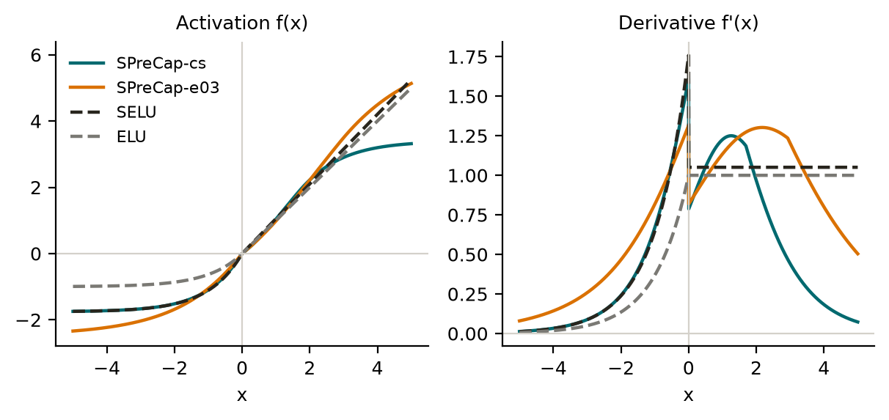
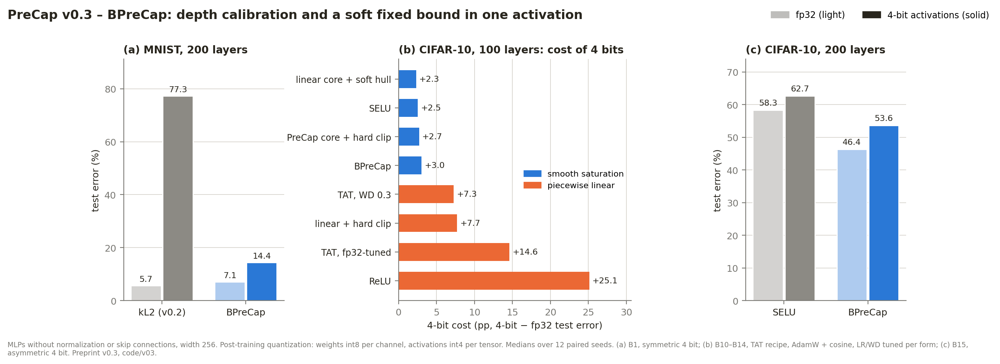
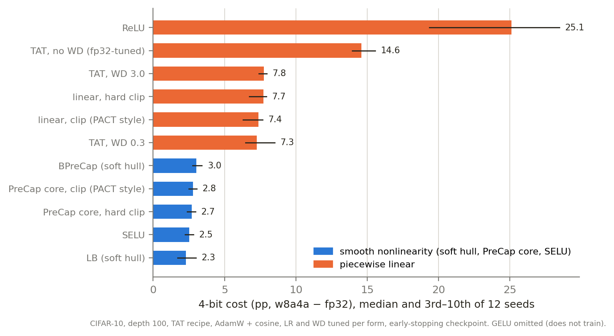
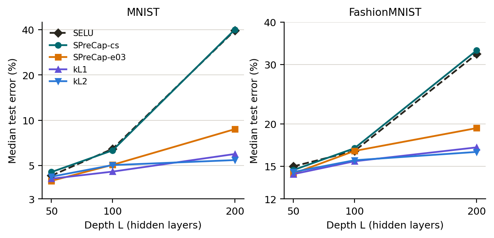
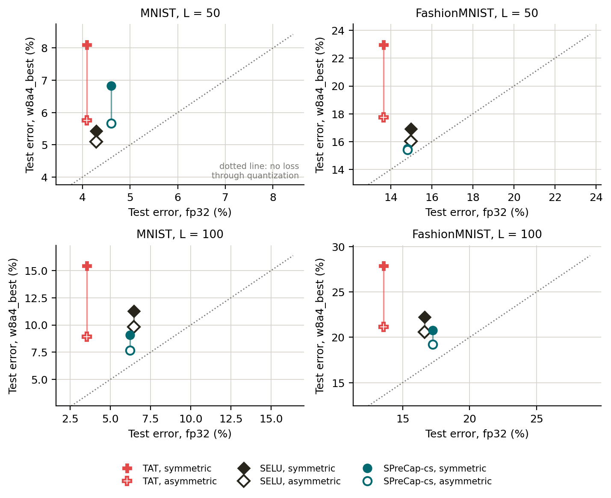

# PreCap / SPreCap – beschränkte, selbstnormierende Aktivierungsfunktion

[](https://doi.org/10.5281/zenodo.23676432) [](https://doi.org/10.5281/zenodo.23676199)

Preprint v0.3.1: Schmitt, A. (2026). PreCap v0.3.1: A Depth-Calibrated Activation with a Soft Fixed Bound for Deep Normalization-Free MLPs – Training Depth and 4-Bit Robustness in One Form (Version 0.3.1). Zenodo. https://doi.org/10.5281/zenodo.23930791 · PDF: [`paper/PreCap_paper_v0.3.1.pdf`](paper/PreCap_paper_v0.3.1.pdf)

Preprint v0.3: Schmitt, A. (2026). PreCap v0.3: A Depth-Calibrated Activation with a Soft Fixed Bound for Deep Normalization-Free MLPs – Training Depth and 4-Bit Robustness in One Form (Version 0.3). Zenodo. https://doi.org/10.5281/zenodo.23894714 · PDF: [`paper/PreCap_paper_v0.3.pdf`](paper/PreCap_paper_v0.3.pdf)

Preprint v0.2: Schmitt, A. (2026). PreCap: Bounded, Self-Normalizing Activations for Deep Normalization-Free MLPs – Depth Calibration, a Comparison with TAT, and 4-Bit Robustness (Version 0.2). Zenodo. https://doi.org/10.5281/zenodo.23757287

Preprint v0.1: https://doi.org/10.5281/zenodo.23676200 · Software: https://doi.org/10.5281/zenodo.23676432 (alle Versionen)

Forschungsprojekt von Aaron Schmitt (ORCID [0009-0009-8689-5848](https://orcid.org/0009-0009-8689-5848)), seit 14.10.2026. v0.1: 26.10.2026, v0.2: 29.10.2026, v0.3: 02.11.2026, v0.3.1: 03.11.2026. Lizenz: Apache-2.0.

English summary: [see below](#english-summary).

## Formel

$$
y(x)=\lambda\cdot\begin{cases}1 & x>0\cr  \alpha & x\le 0\end{cases}\cdot\mathrm{capexp}\big(s\tanh(bx/s)\big),\qquad
\mathrm{capexp}(w)=\begin{cases}e^w-1 & w\le c\cr  e^c-1+e^c\thinspace (w-c) & w>c\end{cases}
$$

mit $s=1{,}5$ und $c=1$. CapExp allein ist exakt ein verschobenes ELU. Erst die weiche tanh-Begrenzung davor macht daraus eine eigene Funktion: glatt, monoton und beidseitig beschränkt. Die Konstanten $\lambda,\alpha$ setzen wie bei SELU Mittelwert 0 und Varianz 1 als Fixpunkt. $b$ stellt den Gradientenfaktor $\chi_1=\mathbb E[f'(z)^2]$ ein.

| Preset | λ | α | b | χ₁ | Wertebereich | Einsatz |
|---|---|---|---|---|---|---|
| `spreccap_cs` (Standard) | 1,102702500 | 2,053776267 | 0,71188112 | 1,0716 (wie SELU) | [−1,76; 3,39] | Hauptvariante v0.1 |
| `spreccap_e03` | 1,985552225 | 1,608136397 | 0,4118896262 | 1,0300 | [−2,48; 6,11] | sehr tiefe Netze (100 Schichten) |
| `spreccap` | 0,80676869644 | 2,39695130922 | 1 | 1,1305 | [−1,50; 2,48] | historisch, schlechter |
| `precap0` | 1 | 1 | 1 | – | [−0,78; 3,08] | Grundform, nicht selbstnormierend |
| `spreccap_kl2_d50` | 1,614100769 | 1,739743617 | 0,496159697 | 1,040 | [−2,18; 4,97] | Tiefenfamilie kL2, 50 Schichten (v0.2) |
| `spreccap_kl2_d100` (= `spreccap_kl1_d50`) | 2,649586999 | 1,461343209 | 0,318766948 | 1,020 | [−3,01; 8,15] | kL2, 100 Schichten |
| `spreccap_kl2_d200` (= `spreccap_kl1_d100`) | 4,170485099 | 1,296823062 | 0,212387949 | 1,010 | [−4,20; 12,83] | kL2, 200 Schichten |
| `spreccap_kl1_d200` | 6,296620086 | 1,197830367 | 0,145678357 | 1,005 | [−5,86; 19,38] | kL1, 200 Schichten |

Die Tiefenfamilie setzt $\chi_1 = 1 + k/L$ für $L$ verdeckte Schichten. Sie trainiert sehr tiefe Netze besser, ist aber wegen des größeren Wertebereichs schlecht für 4-Bit-Quantisierung. Dafür ist `spreccap_cs` die bessere Wahl (siehe v0.2 unten).

## Verlauf der Funktion



Links f(x), rechts die Ableitung, jeweils im Vergleich zu SELU und ELU (Abb. 1 im Preprint). Für negative x liegt SPreCap-cs fast auf SELU (gleiche untere Schranke ≈ −1,76). Für positive x sättigt sie weich bei ≈ 3,39, statt linear weiterzuwachsen. Die Ableitung geht dort gegen 0. e03 ist flacher und reicht bis ≈ 6,11.

## Ergebnisse v0.3.1 (03.11.2026)

Ein Nachtrag zu v0.3 mit vier präregistrierten Studien (V1, V1c, V1d, V3) und drei Diagnosen (D2, V1b, D3). Code, Präregistrierungen, Rohdaten und Berichte liegen wie bei v0.3 in [`code/v03/`](code/v03/). Preprint: [`paper/PreCap_paper_v0.3.1.pdf`](paper/PreCap_paper_v0.3.1.pdf). Alle übrigen Ergebnisse von v0.3 sind unverändert.

- **Die LR-Grenze aus v0.3 ist geklärt (D2, V1, V1b):** BPreCap brach bei LR-Spitze 2·10⁻⁴ ein, weil ein LR-Anlauf fehlte, nicht wegen der Hülle. Die lineare Kontrolle LB und ein harter Clip brechen genauso ein, die Gradienten verschwinden zum Eingang hin. Mit 5 % linearem Anlauf trainiert BPreCap bis 3·10⁻⁴, und der 4-Bit-Vorteil gegen TAT hält (−8,82 pp, 12/0).
- **Tiefe 200 mit Anlauf (V1c):** Der 4-Bit-Vorteil gegen SELU hält (−8,15 pp, 12/0). Der Anlauf erhöht aber BPreCaps eigenen 4-Bit-Preis (+1,64 pp, 0/12).
- **Länge des Anlaufs (V1d):** Ein kürzerer Anlauf verringert diesen Preis, beseitigt ihn aber nicht. w8a4a bei 0/1/2,5/5 % Anlauf: 53,6/54,3/54,9/55,3 %. Bei Tiefe 200 und LR 5·10⁻⁵ ist der Anlauf für die Stabilität nicht nötig.
- **Ausreißer je Schicht bei Tiefe 200 (D3):** keine (Kurtosis 2,8, Max/99,99-%-Quantil ≤ 1,005 in jeder Schicht). int8 ist verlustfrei. Rundungsfehler häufen sich bei Tiefe 200 über mehr Schichten an, bevor sie gedämpft werden.
- **PTQ gegen QAT (V3):** TAT mit Quantisierung im Training (LSQ) ist bei 4 Bit 3,0 pp besser als BPreCap mit einfacher PTQ (0/12). Unter QAT sind beide gleich. Mit PTQ allein liegt BPreCap 11,9 pp vor TAT. **Die Hülle ist ein PTQ-Vorteil, kein Ersatz für QAT.**
- **Grenzen:** wie v0.3; QAT nur bei Tiefe 100 auf CIFAR-10.
- **Paket:** unverändert, nur die Versionsnummer ist 0.3.1.

## Ergebnisse v0.3 (02.11.2026)



16 präregistrierte Studien (B1–B15, B10b) und eine beschreibende Diagnose (D1), MLX auf M1 Pro, dazu eine Wiederholung mit PyTorch/CUDA auf einer RTX 4070 (C6). Code, Präregistrierungen, Rohdaten und Berichte: [`code/v03/`](code/v03/). Preprint: [`paper/PreCap_paper_v0.3.pdf`](paper/PreCap_paper_v0.3.pdf).

- **Eine Form für Tiefe und 4 Bit (BPreCap):** Der tiefenkalibrierte PreCap-Kern sitzt in einer weichen, festen Hülle (M = 3). Bei 200 Schichten auf MNIST bleibt der 4-Bit-Fehler bei 14 %, beim tiefenkalibrierten kL2 aus v0.2 sind es 77 %.
- **Gegen TAT im gleichen Rezept:** auf CIFAR-10 in fp32 gleichauf, bei asymmetrischen 4 Bit in jedem geprüften Regime besser. Die vorsichtige Größe ist −3,8 pp, gegen TAT mit Gewichtsabfall −4,5 pp. Auf CIFAR-100 −1,9 pp, dort über bessere fp32-Güte. Der 4-Bit-Preis von BPreCap bleibt bei etwa +3 pp, der von TAT schwankt mit LR und WD zwischen +7 und +15 pp.
- **Gewöhnliche Aktivierungen:**
  - ReLU und GELU trainieren in 100 Schichten ohne Normierung kaum.
  - **SELU ist bei Tiefe 100 bei 4 Bit gleichauf**, mit ebenso kleinem 4-Bit-Preis. BPreCap ist dort in fp32 nur 0,95 pp besser.
  - **Bei Tiefe 200 fällt SELU klar zurück (B15):** BPreCap ist dort 8,95 pp (4 Bit) und 11,97 pp (fp32) besser, jeweils 12/0.
- **Warum (beschreibend):** Den 4-Bit-Vorteil erklärt nicht der Wertebereich. TAT (Leaky ReLU) hat schwere Ausläufer (Kurtosis im Median 12,5 mit und 29 ohne Gewichtsabfall), ein harter Clip dämpft Rundungsfehler über die Tiefe nicht. Glatt sättigende Formen (BPreCap, LB, SELU) haben beides nicht.
- **Weich gegen hart:** Beim linearen Kern ist die weiche Hülle bei 4 Bit klar besser (−4,7 pp), beim PreCap-Kern gibt es keinen Unterschied. Ein lernbarer Clip im PACT-Stil hat unter AdamW nicht gelernt, ein fairer PACT-Vergleich fehlt.
- **Andere Hardware (C6):** Eine eigenständige PyTorch/CUDA-Umsetzung auf einer RTX 4070 wiederholt die Hauptvergleiche (gegen TAT mit WD −5,0 pp, 12/0). Die Mediane je Form liegen höchstens 0,5 pp von den MLX-Läufen entfernt.
- **Grenzen:** nur MLPs, CIFAR und MNIST, nur simulierte Quantisierung nach dem Training, nur kleine Lernraten.



Abb. 4 im Preprint: 4-Bit-Preis (w8a4a − fp32) jeder Form im gleichen Regime (CIFAR-10, Tiefe 100). Glatte Nichtlinearitäten zahlen +2,3 bis +3,0 pp, stückweise lineare +7,3 bis +25,1 pp.

**Neu im Paket:** `BPreCap(depth=100|200)` und `Lagma(M, rho=0.8)` für PyTorch und MLX, jeweils mit fusioniertem Kernel (CUDA über `torch.cuda.jiterator`, Metal über `mx.fast.metal_kernel`), dazu die Referenzen `bprecap_ref`, `lb_ref`, `lagma_hull` und die Presets `BOUNDED`. Tempo siehe [Kernel](#kernel).

## Ergebnisse v0.2 (29.10.2026)

Sieben weitere präregistrierte Studien (A, A2, A3, Q1, Q1b, Q2, Q3, etwa 2.200 Läufe, MLX auf M1 Pro), gleicher Aufbau wie unten. Code, Präregistrierungen, Rohdaten und Berichte: [`code/v02/`](code/v02/README.md). Preprint: [`paper/PreCap_paper_v0.2.pdf`](paper/PreCap_paper_v0.2.pdf).

- **Tiefenkalibrierung (A):** Mit $\chi_1 = 1 + k/L$ sind kL1 und kL2 bei Tiefe 100 und 200 in 8 von 8 Zellen besser als SELU (je 15/15 Seeds). Bei Tiefe 200 misst das vor allem die Trainingsgeschwindigkeit, weil SELU in 1720 Schritten nicht fertig wird. Das Prinzip ist bekannt (DKS, TAT, und für SELU die Grenze $\varepsilon < 1/L$ bei Chen et al., TPAMI 2020). Neu ist nur die beschränkte, selbstnormierende Umsetzung.
- **Vergleich mit TAT (A2, A3):** Mit Gauß-Init ist kL2 in 8 von 8 Zellen schlechter als TAT. Mit dem TAT-Rezept (SUO-Init, Normierung je Beispiel) liegt kL2 in fp32 gleichauf: 2 Zellen besser, 1 schlechter, 5 ohne Unterschied. TAT lief mit Adam statt K-FAC.
- **4-Bit-Aktivierungen (Q1 und Q1b gemeinsam, Q2, Q3):** SPreCap-cs ist bei Tiefe 100 robuster als SELU. Mit Max-Kalibrierung sind es 6–19 pp, mit fairer Kalibrierung nur noch etwa 2 pp, und bei Tiefe 50 ist das Bild gemischt. Gegen TAT ist cs bei 4 Bit besser, symmetrisch in 4/4 Zellen (−1,4 bis −7,7 pp) und asymmetrisch in 3/4 (−1,1 bis −2,2 pp). In fp32 ist TAT klar besser (+0,8 bis +3,9 pp).
- **Zielkonflikt:** Kein einzelnes Mitglied der Familie hat beides. Die Tiefenkalibrierung vergrößert den Wertebereich und kostet die 4-Bit-Robustheit.
- **Grenzen:** nur MLPs, MNIST/Fashion, kurze Budgets, nur simulierte Quantisierung nach dem Training, pro Tensor.



Abb. 7 im Preprint (Studie A): medianer Testfehler gegen die Tiefe, logarithmische Achse. SELU und SPreCap-cs werden bei 200 Schichten in 1720 Schritten nicht fertig trainiert, die Tiefenfamilie kL1/kL2 verschlechtert sich am wenigsten.



Abb. 9 im Preprint (Studie Q3): fp32 waagerecht, 4-Bit-Aktivierungen senkrecht, gefüllt symmetrisch, offen asymmetrisch. Die gepunktete Linie heißt „kein Verlust durch Quantisierung“. TAT ist in fp32 am besten, verliert bei 4 Bit aber am meisten. SPreCap-cs verliert bei Tiefe 100 und bei FashionMNIST mit Tiefe 50 am wenigsten, bei MNIST mit Tiefe 50 verliert SELU weniger.

## Ergebnisse v0.1 (ehrlich)

Phase 3a-3: MLP mit Breite 256, Tiefe 50 und 100, **ohne Normalisierung und ohne Residual**, Adam, eigenes Lernraten-Tuning je Funktion, 15 Bestätigungs-Seeds, präregistriert. Medianer Testfehler:

| Zelle | SPreCap-cs | SPreCap-e03 | SELU | ELU |
|---|---|---|---|---|
| FashionMNIST, 50 | 14,92 % | 14,57 % | 14,69 % | 14,67 % |
| FashionMNIST, 100 | 16,98 % | 16,61 % | 17,29 % | 16,62 % |
| MNIST, 50 | 4,42 % | 4,05 % | 4,31 % | 3,75 % |
| MNIST, 100 | 6,27 % | **5,28 %** | 6,36 % | 5,78 % |

- **SPreCap-cs ist gleichauf mit SELU,** in keiner Zelle signifikant schlechter (Differenz −0,12 bis +0,20 Prozentpunkte). Damit ist die Entscheidungsregel für v0.1 erfüllt. Besser als SELU ist cs nicht.
- **SPreCap-e03 ist bei MNIST mit 100 Schichten signifikant besser als SELU** (Holm p = 0,0064). Das ist ein Sekundärtest und nur eine von vier Zellen.
- **ELU ist genauso stark:** Mittlerer Rang e03 1,5, ELU 1,75, SPreCap-cs und SELU je 4,25. Einen klaren Vorsprung vor ELU hat keine PreCap-Variante.
- **Je näher χ₁ an 1, desto besser:** In allen 4 Zellen sinkt der Fehler streng mit χ₁. Dieselbe Idee steckt in bSELU (Chen et al. 2024). Unsere Daten stützen sie unabhängig für eine beschränkte Funktion.
- **Nicht robuster gegenüber der Lernrate:** Bei LR 5e-4 und Tiefe 50 lernen SELU und ELU, die PreCap-Varianten nicht.
- **Frühere Vorteile in 1D/2D hingen an fester Lernrate** und verschwanden mit fairem Tuning (V18). Das ist dokumentiert.

Paper v0.1: `paper/PreCap_paper.pdf`. Details: `analysis/P3A3_Auswertung.md`, Einordnung: `docs/Recherche_Neuheit.md`, alles zusammen: `docs/PROJEKT_GESAMTDOKUMENTATION.md`.

## Installation und Nutzung

```bash
pip install "precap[torch] @ git+https://github.com/hermi-labs/precap-activation"   # PyTorch (CPU oder CUDA)
pip install "precap[mlx] @ git+https://github.com/hermi-labs/precap-activation"     # Apple Silicon
```

```python
import torch
from precap import PreCap
net = torch.nn.Sequential(torch.nn.Linear(784, 256), PreCap('spreccap_cs'), torch.nn.Linear(256, 10))
# Auf CUDA-Tensoren wird automatisch der fusionierte Kernel genutzt, sonst die Referenz.
# PreCap(backend='ref') erzwingt die Referenz.
```

```python
from precap.mlx import PreCap   # Metal-Kernel, rechnet intern in float32
act = PreCap('spreccap_e03')
```

```python
from precap import BPreCap, Lagma   # v0.3; MLX: from precap.mlx import BPreCap, Lagma
act = BPreCap(depth=100)              # PreCap-Kern in der Lagma-Hülle, Wertebereich (-3, 3), chi1 = 1 + 2/L
hull = Lagma(3.0)                     # nur die weiche Hülle h_M, identisch für |y| <= 0,8·M
# Auf CUDA-Tensoren wird automatisch der fusionierte Kernel genutzt, BPreCap(depth=100, backend='ref') erzwingt die Referenz.
```

Für die Selbstnormierung braucht das Netz wie bei SELU eine Init $W\sim N(0,1/\mathrm{fan}_{\mathrm{in}})$ und standardisierte Eingaben.

Es gibt keine festen Pfade. Der Kernel-Code ist im Paket enthalten, kein CUDA-Toolkit und kein Xcode nötig.

## Kernel

| Gerät | PreCap-Kernel | Referenz (einzelne Operationen) | natives SELU |
|---|---|---|---|
| RTX 4070, CUDA 12.8, torch 2.11 | 0,909 ms | 10,46 ms | 0,89 ms |
| M1 Pro, MLX 0.32.4 | 4,15 ms | 34,1 ms | 11,47 ms |

**v0.3, BPreCap und Lagma** (`kernels/test_bprecap_cuda.py`, `kernels/test_bprecap_mlx.py`):

| Gerät | BPreCap-Kernel | BPreCap-Referenz | Lagma-Kernel | Lagma-Referenz | natives SELU |
|---|---|---|---|---|---|
| RTX 4070, CUDA 12.6, torch 2.14.1 | 1,047 ms | 19,005 ms | 1,044 ms | 8,726 ms | 0,73 ms |
| M1 Pro, MLX 0.32.4 | 3,07 ms | 60,73 ms | 1,98 ms | 21,45 ms | 10,04 ms |

Abweichung gegen float64 höchstens 1,3e-6 vorwärts und 2,2e-6 rückwärts (relativ zu 1 + |g|). Tests: 14/14 (CUDA), 10/10 (MLX).

Gemessen: vorwärts und rückwärts über 16M Elemente in float32. Die MLX-Messung für PreCap (v0.2) lief parallel zu einem Trainingslauf und ist daher eher zu langsam. Tests: 17/17 (CUDA), 12/12 (MLX), Abweichung zur Referenz in fp32 höchstens 1,1e-6.

## Reproduzieren

- Jede Studie hat eine Präregistrierung (`docs/`), eingefrorene Skripte mit SHA-256 (`code/**/meta/frozen_sha256.txt`), Rohdaten oder deren Hashes und eine Auswertung (`analysis/`).
- **Pfade in den eingefrorenen Skripten:** Die Skripte enthalten feste Mac-Pfade wie `DATA=Path('/Users/aaronschmitt/PyCharmMiscProject/data')` (bei `run_p3a3.py` in Zeile 10). Sie dürfen nicht verändert werden, sonst stimmen die Hashes nicht. Zum Nachrechnen eine Kopie anlegen und nur diese Zeile auf den eigenen MNIST-Ordner setzen.
- **Studien v0.3 und v0.3.1** (`code/v03/`): wie v0.2 über `PRECAP_DATA`. Ein Neulauf aus einer sauberen Kopie war bitgleich (B10, 93 von 93 Spalten). CIFAR-Daten liegen nicht im Repo, nur ihre Prüfsummen.
- **Studien v0.2** (`code/v02/`): Die Skripte lesen den Datenordner aus der Umgebungsvariable `PRECAP_DATA`, ohne Änderung am Code. Details in `code/v02/README.md`.
- Paket-Tests: `pip install -e ".[torch,test]" && pytest tests`. Kernel-Tests: `kernels/README.md`.

## Struktur

| Ordner | Inhalt |
|---|---|
| `paper/` | Preprints als PDF (`PreCap_paper_v0.3.1.pdf`, `PreCap_paper_v0.3.pdf`, `PreCap_paper_v0.2.pdf`, `PreCap_paper.pdf` = v0.1), Grafiken und Quellskripte |
| `src/precap/` | installierbares Paket (PyTorch + CUDA-Kernel, MLX + Metal-Kernel) |
| `kernels/` | eigenständige Kernel mit Tests und Messergebnissen |
| `code/` | alle Studien 1D, 2D, 3D, Phase 3, `v02/` und `v03/` mit Hashes |
| `analysis/` | Auswertungen |
| `docs/` | Präregistrierungen, Gesamtdoku, Fahrplan, Recherche, [Danksagung](docs/Danksagung_und_Werkzeuge.md) |
| `math/` | Herleitungen der Konstanten und Mean-Field-Rechnungen |
| `literatur/` | Literaturrecherche |
| `notizen/` | handschriftliche Notizen |

## Zitieren

Siehe `CITATION.cff`. Preprint v0.3.1: https://doi.org/10.5281/zenodo.23930791. Preprint v0.3: https://doi.org/10.5281/zenodo.23894714. Preprint v0.2: https://doi.org/10.5281/zenodo.23757287. Alle Versionen des Preprints: https://doi.org/10.5281/zenodo.23676199

---

## English summary

**PreCap** is a smooth, monotonic, bounded activation: an exponential-linear unit (CapExp, exactly a shifted ELU) applied after a soft tanh clip, $y=\lambda\thinspace [x>0\thinspace ?\thinspace 1:\alpha]\cdot\mathrm{capexp}(s\tanh(bx/s))$ with $s=1.5,\ c=1$. **SPreCap** chooses $\lambda,\alpha$ for the SELU fixed point (mean 0, variance 1) and $b$ to set the gradient gain $\chi_1$.


Figure 1 of the preprint. Left: f(x), right: f'(x). For x < 0, SPreCap-cs nearly matches SELU (same lower bound ≈ −1.76). For x > 0 it saturates smoothly at ≈ 3.39 instead of growing linearly, so the derivative returns toward 0. e03 is flatter (range up to ≈ 6.11).

In a preregistered study on 50- and 100-layer MLPs without normalization or residuals (MNIST, FashionMNIST, per-activation LR tuning, 15 seeds), **SPreCap-cs matches SELU** (no cell significantly worse, differences −0.12 to +0.20 pp). It is not better overall. The variant **SPreCap-e03 ($\chi_1=1.03$) beats SELU on MNIST at depth 100** (5.28 % vs 6.36 %, Holm p = 0.0064, secondary test). Plain ELU is about as strong (mean rank e03 1.5, ELU 1.75). The test error decreases monotonically as $\chi_1\to1$, consistent with bSELU (Chen et al. 2024). PreCap is **not** more robust to the learning rate. Earlier advantages at a fixed learning rate disappeared under fair tuning. Negative results are documented.

**Version 0.2** adds seven preregistered studies (about 2,200 runs). A depth-calibrated family with $\chi_1 = 1 + k/L$ (kL1, kL2) trains 100- and 200-layer MLPs clearly better than SELU (8/8 cells); the principle is known (DKS, TAT, and the bound $\varepsilon < 1/L$ for SELU by Chen et al., TPAMI 2020). With TAT's own recipe, kL2 is on par with TAT in fp32 (2 better, 1 worse, 5 inconclusive). The bounded SPreCap-cs is more robust to post-training 4-bit activation quantization than SELU at depth 100 (about 2 pp with fair calibration) and than TAT (symmetric 4/4 cells, −1.4 to −7.7 pp; asymmetric 3/4, −1.1 to −2.2 pp), while TAT is better in fp32. No single variant has both properties. Preprint v0.2: https://doi.org/10.5281/zenodo.23757287, code and data: `code/v02/`.

**Version 0.3** puts the depth-calibrated PreCap core inside a soft, fixed bound (BPreCap). In 16 preregistered studies on 100- and 200-layer MLPs without normalization or skips, BPreCap is on par with TAT in fp32 under TAT's recipe on CIFAR-10 and better at 4-bit activations in every tested regime (cautious size −3.8 pp; CIFAR-100 −1.9 pp). Its 4-bit cost stays at about +3 pp while TAT's varies from +7 to +15 pp with learning rate and weight decay. ReLU and GELU do not train well at depth 100; SELU matches BPreCap at 4 bits at depth 100 but falls clearly behind at depth 200 (−8.95 pp at 4 bits, −11.97 pp in fp32). A diagnosis points to heavy-tailed activations (TAT) and missing damping of rounding errors (hard clip), not to the activation range. An independent PyTorch/CUDA replication on an RTX 4070 reproduces the main comparisons (medians within 0.5 pp). All negative results are reported. New in the package: `BPreCap(depth=100|200)` and the soft hull `Lagma(M)` with fused kernels (RTX 4070: 1.05 ms vs 0.73 ms for native SELU; M1 Pro: 3.07 ms vs 10.04 ms for MLX SELU; 16M elements fwd+bwd). Preprint v0.3: https://doi.org/10.5281/zenodo.23894714, code and data: `code/v03/`.

**Version 0.3.1** adds four preregistered studies and three diagnoses. The learning-rate limit of v0.3 was caused by missing warmup, not by the bound: with a 5 % linear warmup BPreCap trains up to 3·10⁻⁴ at depth 100 and its 4-bit advantage over TAT holds (−8.82 pp, 12/0); at depth 200 the advantage over SELU holds as well (−8.15 pp, 12/0). Warmup, however, raises BPreCap's own 4-bit cost at depth 200, and a shorter warmup reduces but does not remove this (w8a4a 53.6 / 54.3 / 54.9 / 55.3 % at 0 / 1 / 2.5 / 5 %). At depth 200 there are no per-layer outliers and int8 is lossless. With quantization-aware training (LSQ), TAT is 3.0 pp better at 4 bits than BPreCap with plain post-training quantization, and under QAT both are equal: the bound is a PTQ advantage, not a substitute for QAT. Preprint v0.3.1: https://doi.org/10.5281/zenodo.23930791, code and data: `code/v03/`.

Fused kernels (v0.2, PreCap): CUDA via `torch.cuda.jiterator` (RTX 4070, 16M elements fwd+bwd: 0.91–1.06 ms vs 0.73–0.89 ms for native SELU, i.e. up to about 1.5×; fp16/bf16 work but go through fp32) and MLX/Metal (4.15 ms vs MLX SELU 11.47 ms on an M1 Pro). Install with `pip install "precap[torch] @ git+https://github.com/hermi-labs/precap-activation"` and use `from precap import PreCap`.
