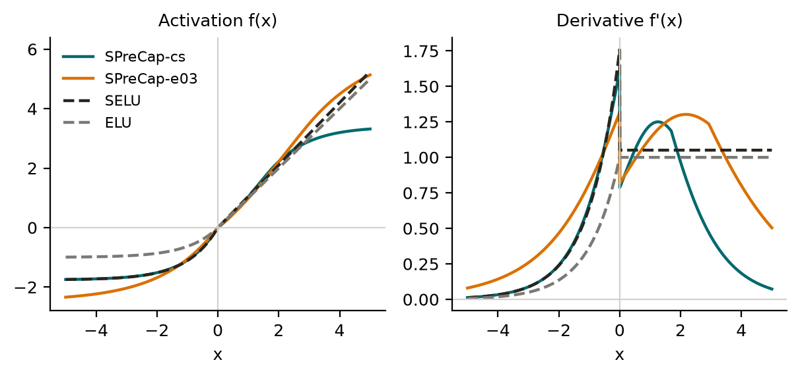

# PreCap / SPreCap – beschränkte, selbstnormierende Aktivierungsfunktion

[](https://doi.org/10.5281/zenodo.23676432) [](https://doi.org/10.5281/zenodo.23676199)

Preprint v0.2: Schmitt, A. (2026). PreCap: Bounded, Self-Normalizing Activations for Deep Normalization-Free MLPs – Depth Calibration, a Comparison with TAT, and 4-Bit Robustness (Version 0.2). Zenodo. https://doi.org/10.5281/zenodo.23757287

Preprint v0.1: https://doi.org/10.5281/zenodo.23676200 · Software: https://doi.org/10.5281/zenodo.23676432 (alle Versionen)

Forschungsprojekt von Aaron Schmitt (ORCID [0009-0009-8689-5848](https://orcid.org/0009-0009-8689-5848)), seit 14.10.2026. v0.1: 26.10.2026, v0.2: 29.10.2026. Lizenz: Apache-2.0.

English summary: [see below](#english-summary).

## Formel

$$
y(x)=\lambda\cdot\begin{cases}1 & x>0\cr  \alpha & x\le 0\end{cases}\cdot\mathrm{capexp}\big(s\tanh(bx/s)\big),\qquad
\mathrm{capexp}(w)=\begin{cases}e^w-1 & w\le c\cr  e^c-1+e^c\thinspace (w-c) & w>c\end{cases}
$$

mit $s=1{,}5$ und $c=1$. CapExp allein ist exakt ein verschobenes ELU. Erst die weiche tanh-Begrenzung davor macht daraus eine eigene Funktion: glatt, monoton und beidseitig beschränkt. Die Konstanten $\lambda,\alpha$ setzen wie bei SELU Mittelwert 0 und Varianz 1 als Fixpunkt. $b$ stellt den Gradientenfaktor $\chi_1=\mathbb E[f'(z)^2]$ ein.

| Preset | λ | α | b | χ₁ | Wertebereich | Einsatz |
|---|---|---|---|---|---|---|
| `spreccap_cs` (Standard) | 1,102702500 | 2,053776267 | 0,71188112 | 1,0716 (wie SELU) | [−1,76; 3,39] | Hauptvariante v0.1 |
| `spreccap_e03` | 1,985552225 | 1,608136397 | 0,4118896262 | 1,0300 | [−2,48; 6,11] | sehr tiefe Netze (100 Schichten) |
| `spreccap` | 0,80676869644 | 2,39695130922 | 1 | 1,1305 | [−1,50; 2,48] | historisch, schlechter |
| `precap0` | 1 | 1 | 1 | – | [−0,78; 3,08] | Grundform, nicht selbstnormierend |
| `spreccap_kl2_d50` | 1,614100769 | 1,739743617 | 0,496159697 | 1,040 | [−2,18; 4,97] | Tiefenfamilie kL2, 50 Schichten (v0.2) |
| `spreccap_kl2_d100` (= `spreccap_kl1_d50`) | 2,649586999 | 1,461343209 | 0,318766948 | 1,020 | [−3,01; 8,15] | kL2, 100 Schichten |
| `spreccap_kl2_d200` (= `spreccap_kl1_d100`) | 4,170485099 | 1,296823062 | 0,212387949 | 1,010 | [−4,20; 12,83] | kL2, 200 Schichten |
| `spreccap_kl1_d200` | 6,296620086 | 1,197830367 | 0,145678357 | 1,005 | [−5,86; 19,38] | kL1, 200 Schichten |

Die Tiefenfamilie setzt $\chi_1 = 1 + k/L$ für $L$ verdeckte Schichten. Sie trainiert sehr tiefe Netze besser, ist aber wegen des größeren Wertebereichs schlecht für 4-Bit-Quantisierung. Dafür ist `spreccap_cs` die bessere Wahl (siehe v0.2 unten).

## Verlauf der Funktion



Links f(x), rechts die Ableitung, jeweils im Vergleich zu SELU und ELU (Abb. 1 im Preprint). Für negative x liegt SPreCap-cs fast auf SELU (gleiche untere Schranke ≈ −1,76). Für positive x sättigt sie weich bei ≈ 3,39, statt linear weiterzuwachsen. Die Ableitung geht dort gegen 0. e03 ist flacher und reicht bis ≈ 6,11.

## Ergebnisse v0.2 (29.10.2026)

Sieben weitere präregistrierte Studien (A, A2, A3, Q1, Q1b, Q2, Q3, etwa 2.200 Läufe, MLX auf M1 Pro), gleicher Aufbau wie unten. Code, Präregistrierungen, Rohdaten und Berichte: [`code/v02/`](code/v02/README.md). Preprint: [`paper/PreCap_paper_v0.2.pdf`](paper/PreCap_paper_v0.2.pdf).

- **Tiefenkalibrierung (A):** Mit $\chi_1 = 1 + k/L$ sind kL1 und kL2 bei Tiefe 100 und 200 in 8 von 8 Zellen besser als SELU (je 15/15 Seeds). Bei Tiefe 200 misst das vor allem die Trainingsgeschwindigkeit, weil SELU in 1720 Schritten nicht fertig wird. Das Prinzip ist bekannt (DKS, TAT, und für SELU die Grenze $\varepsilon < 1/L$ bei Chen et al., TPAMI 2020). Neu ist nur die beschränkte, selbstnormierende Umsetzung.
- **Vergleich mit TAT (A2, A3):** Mit Gauß-Init ist kL2 in 8 von 8 Zellen schlechter als TAT. Mit dem TAT-Rezept (SUO-Init, Normierung je Beispiel) liegt kL2 in fp32 gleichauf: 2 Zellen besser, 1 schlechter, 5 ohne Unterschied. TAT lief mit Adam statt K-FAC.
- **4-Bit-Aktivierungen (Q1 und Q1b gemeinsam, Q2, Q3):** SPreCap-cs ist bei Tiefe 100 robuster als SELU. Mit Max-Kalibrierung sind es 6–19 pp, mit fairer Kalibrierung nur noch etwa 2 pp, und bei Tiefe 50 ist das Bild gemischt. Gegen TAT ist cs bei 4 Bit besser, symmetrisch in 4/4 Zellen (−1,4 bis −7,7 pp) und asymmetrisch in 3/4 (−1,1 bis −2,2 pp). In fp32 ist TAT klar besser (+0,8 bis +3,9 pp).
- **Zielkonflikt:** Kein einzelnes Mitglied der Familie hat beides. Die Tiefenkalibrierung vergrößert den Wertebereich und kostet die 4-Bit-Robustheit.
- **Grenzen:** nur MLPs, MNIST/Fashion, kurze Budgets, nur simulierte Quantisierung nach dem Training, pro Tensor.

## Ergebnisse v0.1 (ehrlich)

Phase 3a-3: MLP mit Breite 256, Tiefe 50 und 100, **ohne Normalisierung und ohne Residual**, Adam, eigenes Lernraten-Tuning je Funktion, 15 Bestätigungs-Seeds, präregistriert. Medianer Testfehler:

| Zelle | SPreCap-cs | SPreCap-e03 | SELU | ELU |
|---|---|---|---|---|
| FashionMNIST, 50 | 14,92 % | 14,57 % | 14,69 % | 14,67 % |
| FashionMNIST, 100 | 16,98 % | 16,61 % | 17,29 % | 16,62 % |
| MNIST, 50 | 4,42 % | 4,05 % | 4,31 % | 3,75 % |
| MNIST, 100 | 6,27 % | **5,28 %** | 6,36 % | 5,78 % |

- **SPreCap-cs ist gleichauf mit SELU,** in keiner Zelle signifikant schlechter (Differenz −0,12 bis +0,20 Prozentpunkte). Damit ist die Entscheidungsregel für v0.1 erfüllt. Besser als SELU ist cs nicht.
- **SPreCap-e03 ist bei MNIST mit 100 Schichten signifikant besser als SELU** (Holm p = 0,0064). Das ist ein Sekundärtest und nur eine von vier Zellen.
- **ELU ist genauso stark:** Mittlerer Rang e03 1,5, ELU 1,75, SPreCap-cs und SELU je 4,25. Einen klaren Vorsprung vor ELU hat keine PreCap-Variante.
- **Je näher χ₁ an 1, desto besser:** In allen 4 Zellen sinkt der Fehler streng mit χ₁. Dieselbe Idee steckt in bSELU (Chen et al. 2024). Unsere Daten stützen sie unabhängig für eine beschränkte Funktion.
- **Nicht robuster gegenüber der Lernrate:** Bei LR 5e-4 und Tiefe 50 lernen SELU und ELU, die PreCap-Varianten nicht.
- **Frühere Vorteile in 1D/2D hingen an fester Lernrate** und verschwanden mit fairem Tuning (V18). Das ist dokumentiert.

Paper v0.1: `paper/PreCap_paper.pdf`. Details: `analysis/P3A3_Auswertung.md`, Einordnung: `docs/Recherche_Neuheit.md`, alles zusammen: `docs/PROJEKT_GESAMTDOKUMENTATION.md`.

## Installation und Nutzung

```bash
pip install "precap[torch] @ git+https://github.com/hermi-labs/precap-activation"   # PyTorch (CPU oder CUDA)
pip install "precap[mlx] @ git+https://github.com/hermi-labs/precap-activation"     # Apple Silicon
```

```python
import torch
from precap import PreCap
net = torch.nn.Sequential(torch.nn.Linear(784, 256), PreCap('spreccap_cs'), torch.nn.Linear(256, 10))
# Auf CUDA-Tensoren wird automatisch der fusionierte Kernel genutzt, sonst die Referenz.
# PreCap(backend='ref') erzwingt die Referenz.
```

```python
from precap.mlx import PreCap   # Metal-Kernel, rechnet intern in float32
act = PreCap('spreccap_e03')
```

Für die Selbstnormierung braucht das Netz wie bei SELU eine Init $W\sim N(0,1/\mathrm{fan}_{\mathrm{in}})$ und standardisierte Eingaben.

Es gibt keine festen Pfade. Der Kernel-Code ist im Paket enthalten, kein CUDA-Toolkit und kein Xcode nötig.

## Kernel

| Gerät | PreCap-Kernel | Referenz (einzelne Operationen) | natives SELU |
|---|---|---|---|
| RTX 4070, CUDA 12.8, torch 2.11 | 0,909 ms | 10,46 ms | 0,89 ms |
| M1 Pro, MLX 0.32.4 | 4,15 ms | 34,1 ms | 11,47 ms |

Gemessen: vorwärts und rückwärts über 16M Elemente in float32. Die MLX-Messung lief parallel zu einem Trainingslauf und ist daher eher zu langsam. Tests: 17/17 (CUDA), 12/12 (MLX), Abweichung zur Referenz in fp32 höchstens 1,1e-6.

## Reproduzieren

- Jede Studie hat eine Präregistrierung (`docs/`), eingefrorene Skripte mit SHA-256 (`code/**/meta/frozen_sha256.txt`), Rohdaten oder deren Hashes und eine Auswertung (`analysis/`).
- **Pfade in den eingefrorenen Skripten:** Die Skripte enthalten feste Mac-Pfade wie `DATA=Path('/Users/aaronschmitt/PyCharmMiscProject/data')` (bei `run_p3a3.py` in Zeile 10). Sie dürfen nicht verändert werden, sonst stimmen die Hashes nicht. Zum Nachrechnen eine Kopie anlegen und nur diese Zeile auf den eigenen MNIST-Ordner setzen.
- **Studien v0.2** (`code/v02/`): Die Skripte lesen den Datenordner aus der Umgebungsvariable `PRECAP_DATA`, ohne Änderung am Code. Details in `code/v02/README.md`.
- Paket-Tests: `pip install -e ".[torch,test]" && pytest tests`. Kernel-Tests: `kernels/README.md`.

## Struktur

| Ordner | Inhalt |
|---|---|
| `paper/` | Preprints als PDF (`PreCap_paper_v0.2.pdf`, `PreCap_paper.pdf` = v0.1), Grafiken und Quellskripte |
| `src/precap/` | installierbares Paket (PyTorch + CUDA-Kernel, MLX + Metal-Kernel) |
| `kernels/` | eigenständige Kernel mit Tests und Messergebnissen |
| `code/` | alle Studien 1D, 2D, 3D, Phase 3 und `v02/` mit Hashes |
| `analysis/` | Auswertungen |
| `docs/` | Präregistrierungen, Gesamtdoku, Fahrplan, Recherche, [Danksagung](docs/Danksagung_und_Werkzeuge.md) |
| `math/` | Herleitungen der Konstanten und Mean-Field-Rechnungen |
| `literatur/` | Literaturrecherche |
| `notizen/` | handschriftliche Notizen |

## Zitieren

Siehe `CITATION.cff`. Preprint v0.2: https://doi.org/10.5281/zenodo.23757287. Alle Versionen des Preprints: https://doi.org/10.5281/zenodo.23676199

---

## English summary

**PreCap** is a smooth, monotonic, bounded activation: an exponential-linear unit (CapExp, exactly a shifted ELU) applied after a soft tanh clip, $y=\lambda\thinspace [x>0\thinspace ?\thinspace 1:\alpha]\cdot\mathrm{capexp}(s\tanh(bx/s))$ with $s=1.5,\ c=1$. **SPreCap** chooses $\lambda,\alpha$ for the SELU fixed point (mean 0, variance 1) and $b$ to set the gradient gain $\chi_1$.


Figure 1 of the preprint. Left: f(x), right: f'(x). For x < 0, SPreCap-cs nearly matches SELU (same lower bound ≈ −1.76). For x > 0 it saturates smoothly at ≈ 3.39 instead of growing linearly, so the derivative returns toward 0. e03 is flatter (range up to ≈ 6.11).

In a preregistered study on 50- and 100-layer MLPs without normalization or residuals (MNIST, FashionMNIST, per-activation LR tuning, 15 seeds), **SPreCap-cs matches SELU** (no cell significantly worse, differences −0.12 to +0.20 pp). It is not better overall. The variant **SPreCap-e03 ($\chi_1=1.03$) beats SELU on MNIST at depth 100** (5.28 % vs 6.36 %, Holm p = 0.0064, secondary test). Plain ELU is about as strong (mean rank e03 1.5, ELU 1.75). The test error decreases monotonically as $\chi_1\to1$, consistent with bSELU (Chen et al. 2024). PreCap is **not** more robust to the learning rate. Earlier advantages at a fixed learning rate disappeared under fair tuning. Negative results are documented.

**Version 0.2** adds seven preregistered studies (about 2,200 runs). A depth-calibrated family with $\chi_1 = 1 + k/L$ (kL1, kL2) trains 100- and 200-layer MLPs clearly better than SELU (8/8 cells); the principle is known (DKS, TAT, and the bound $\varepsilon < 1/L$ for SELU by Chen et al., TPAMI 2020). With TAT's own recipe, kL2 is on par with TAT in fp32 (2 better, 1 worse, 5 inconclusive). The bounded SPreCap-cs is more robust to post-training 4-bit activation quantization than SELU at depth 100 (about 2 pp with fair calibration) and than TAT (symmetric 4/4 cells, −1.4 to −7.7 pp; asymmetric 3/4, −1.1 to −2.2 pp), while TAT is better in fp32. No single variant has both properties. Preprint v0.2: https://doi.org/10.5281/zenodo.23757287, code and data: `code/v02/`.

Fused kernels: CUDA via `torch.cuda.jiterator` (RTX 4070, 16M elements fwd+bwd: 0.91–1.06 ms vs 0.73–0.89 ms for native SELU, i.e. up to about 1.5×; fp16/bf16 work but go through fp32) and MLX/Metal (4.15 ms vs MLX SELU 11.47 ms on an M1 Pro). Install with `pip install "precap[torch] @ git+https://github.com/hermi-labs/precap-activation"` and use `from precap import PreCap`.
